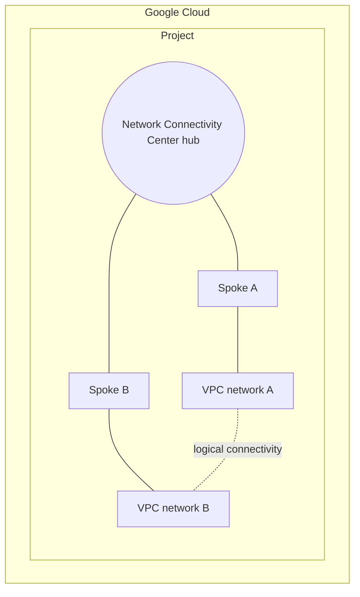
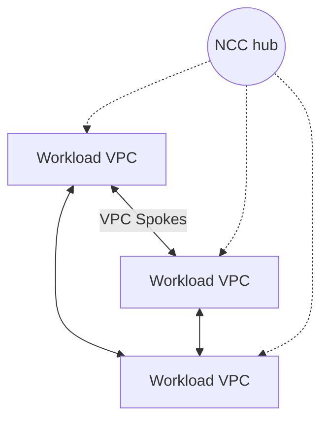

# Network Connectivity Center (NCC)

## Table of contents

1. [Network Connectivity Center overview](#network-connectivity-center-overview)
2. [Hub](#hub)
3. [Spokes](#spokes)
4. [VPC spokes overview](#vpc-spokes-overview)
5. [Comparison to VPC Network Peering](#comparison-to-vpc-network-peering)
6. [Preset topologies](#preset-topologies)
7. [Mesh topology](#mesh-topology)
8. [Limitations](#limitations)

---

## Network Connectivity Center overview

- Network Connectivity Center is an orchestration framework that simplifies network connectivity among *spoke* resources that are connected to a central management resource called a *hub*.
- Network Connectivity Center supports three types of spokes:
  - Virtual Private Cloud (VPC) spokes
  - Producer VPC spokes (Preview)
  - Hybrid spokes
- Connect multiple VPC networks to one another. The VPC networks can be located across different projects in the same Google Cloud organization or different organizations.
- Connect multiple VPC networks to on-premise or other cloud provider networks. These external networks can be reachable through any type of hybrid spoke. This approach is known as *site-to-cloud connectivity*.
- Use Router appliance VMs to manage connectivity between your VPC networks.
- Use a Google Cloud VPC network as an enterprise wide area network (WAN) to connect networks that are outside of Google Cloud. You can establish connectivity between your external sites by using any type of hybrid spoke. This approach is known as *site-to-site connectivity*.

---

## Hub

- A Network Connectivity Center hub is a global resource to which you attach spokes. A single hub can contain spokes from multiple regions.
- However, if any of the spokes of a hub use the site-to-site data transfer feature, the resources associated with those spokes must all be in the same VPC network.
- Spokes that don't use site-to-site data transfer can be associated with any VPC network in your project.

**Diagram (from the slide):**

Legend: dotted line = logical connectivity; solid line = data plane connectivity.

## Spokes

A spoke represents one or more Google Cloud network resources that are connected to a hub.

---

## VPC spokes overview

- Network Connectivity Center provides inter-VPC network connectivity at scale with the support for VPC spokes.
- VPC spokes reduce the operational complexity of managing the individual pair-wise VPC Network Peering connections through the use of VPC spokes and a centralized connectivity management model.
- VPC spokes can export and import all subnet routes from other spoke VPCs on a Network Connectivity Center hub. This ensures full connectivity between all workloads that reside in all these VPC networks.
- Inter-VPC network traffic stays within the Google Cloud network and does not travel through the internet, which helps to ensure privacy and security.
- VPC spokes can be in the same project and organization or in a different project and organization from the Network Connectivity Center hub. A VPC spoke can be connected to one hub at a time.

---

## Comparison to VPC Network Peering

| Feature | VPC Network Peering | VPC spokes |
|---|---|---|
| VPC networks | Peerings per VPC network | Active VPC spokes per hub |
| Subnet ranges (subnet routes) | Subnetwork ranges per peering group | Subnetwork routes per route table |
| Static and dynamic routes | Static routes per peering group  Dynamic routes per region per peering group | Unique dynamic route prefixes per hub route table per region.  Static route exchange is not supported. |
| Inter-VPC NAT | Not supported | Supported |
| IP addressing | Internal IPv4 addresses, including private IPv4 addresses and privately used public IPv4 addresses. Internal and external IPv6 addresses. | Private internal IPv4 addresses only, *excluding* privately used public IPv4 addresses. Internal and external IPv6 addresses (Preview). |
| IP address families | • Exchange only IPv4 subnet ranges • Exchange both IPv4 and IPv6 subnet ranges | • Exchange only IPv4 subnet ranges • Exchange both IPv4 and IPv6 subnet ranges. • Exchange only IPv6 subnet ranges |

---

## Preset topologies

- Network Connectivity Center lets you specify the desired connectivity configuration across all VPC spokes. You can choose one of the following two preset topologies:
  - Mesh topology
  - Star topology
- If the topology isn't specified, it defaults to mesh. Once set during hub creation, you can't change the topology of a given hub.
- To change the topology settings of a spoke, you can delete the spoke and create a new spoke with a new hub that uses a different topology.

---

## Mesh topology

- Mesh topology provides high scale network connectivity between VPC spokes. This topology lets all spokes connect to and communicate with each other.
- Subnets within these VPC spokes are fully reachable unless you specify exclude export filters.
- All spokes within the mesh topology belong to a single default *group*. Mesh topology is supported on VPC and hybrid spoke types.

**Diagram (from the slide):**

Legend: solid line = data plane connectivity; dotted line = control plane connectivity.

---

## Limitations

- VPC networks can connect with each other in an exclusive manner through either the Network Connectivity Center hub or through VPC Network Peering.
- VPCs connected together by using Network Connectivity Center and VPC Network Peering in any combination are not transitive.
- Static routes exchange across VPC spokes isn't supported.
- Overlapping subnets must be masked by exclude export filters.
- IPv6 dynamic route exchange isn't supported.
- Auto mode VPC networks are not supported as VPC spokes.
